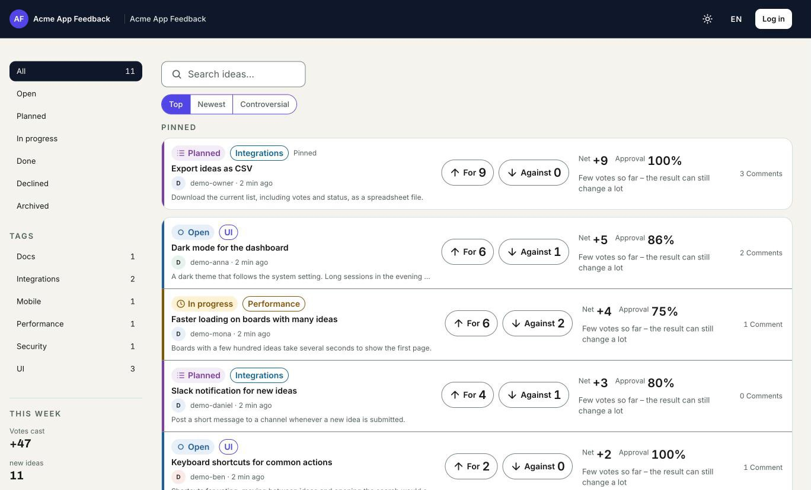
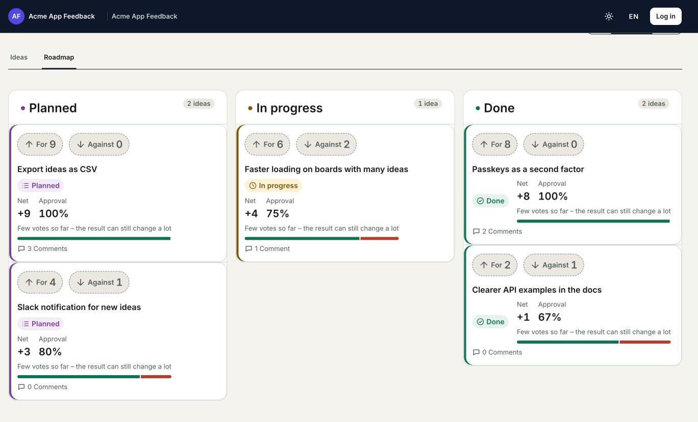

<div align="center">

<picture>
  <source media="(prefers-color-scheme: dark)" srcset="public/assets/brand/votepit-lockup-community-dark.png">
  
</picture>

**The self-hosted feature-voting board with real up- _and_ down-votes.**<br>
Runs on the PHP/MySQL webspace you already have. No Docker, no extra runtime.

[votepit.com](https://votepit.com) · [Documentation](documentation/README.md) · [Installation](#installation) · [MIT License](LICENSE) <!-- export-ok: cloud-origin -->

[](LICENSE) [](#requirements) [](#requirements) [](https://github.com/silvio-l/Votepit/stargazers)

<br>

<picture>
  <source media="(prefers-color-scheme: dark)" srcset="documentation/images/board-dark.jpg">
  
</picture>

</div>

---

## Quick start

On a fresh Ubuntu/Debian VPS (with `sudo`), one line installs and configures everything:

```bash
curl -fsSL https://raw.githubusercontent.com/silvio-l/votepit/main/install.sh | bash
```

The installer checks PHP and the database, asks for the install directory, database access and your
base URL, writes the configuration with generated secrets and runs the migrations. Shared hosting
without SSH: upload the release archive instead, see [Installation](#installation).

Votepit Community Edition is a self-hosted **feature-voting board**. Your users post ideas and vote them **up _or_ down**, so you see not only what people want but also what they would rather not have. One installation serves many boards (one per project), and sign-in works without a password via magic link.

- **Honest signal:** every idea shows For, Against, net score and approval rate, with a hint while there are only a few votes.
- **Fits your hosting:** classic PHP/MySQL shared hosting, uploaded over FTPES. An optional Docker package exists too.
- **Free and complete:** MIT-licensed, no plans, no limits, no payment code. Every installation runs with all features.
- **Privacy by design:** sign-in identities are stored only as an HMAC of the e-mail address; users can export or delete their own data.

## Features

### For your users

- Public boards per project, sorted by **Top**, **Newest** or **Controversial**, filterable by status and tag
- **Up/down voting**, exactly one vote per idea per user (enforced server-side via a `UNIQUE` constraint)
- **Optional anonymous voting** per board (off by default); anonymous voters can leave an e-mail to hear about status changes
- Submit, edit and withdraw ideas; comments with **emoji reactions**
- **Duplicate detection as you type**: MySQL FULLTEXT recall plus Jaro–Winkler reranking, no LLM or external service
- A **roadmap view** with planned, in-progress and done ideas
- Passwordless **magic-link sign-in**, optional password with TOTP two-factor authentication, or **Google/GitHub OAuth**
- **Profile management** (avatar, display name, social links) and **self-service data export and deletion** (JSON/CSV, 48 h undo window)
- **In-app notification inbox**, plus user support requests and an admin-managed FAQ
- **Opt-in e-mail notifications** for participants (status changes, replies, followed ideas, a digest) with one-click unsubscribe
- **Guest ideas** per board (off by default): submissions without an account, verified by Cloudflare Turnstile and held for approval
- **Optional machine translation** of ideas, comments and intros through your own Google Cloud Translation key (off by default, opt-in per board)

<p align="center">
  
</p>

### For you and your team

- **Multi-board** from a single installation (`/{board-slug}/…`), each with its own name, accent colour and intro
- Moderation: set status, pin, moderate posts, block users, **merge duplicates** (voters counted once, merges can be undone)
- **Roles & invitations**: invite moderators by e-mail, manage members and roles
- Per-board SMTP override on top of the global mailer

### For developers

- **Agent API & MCP**: board-scoped, rate-limited REST API and an MCP endpoint for AI agents, secured by admin-issued API tokens (with OAuth 2.1 sign-in for MCP clients) — plus [`@votepit/cli`](packages/cli/README.md), a zero-dependency CLI for the same API
- **Embeddable widget**: show a public or unlisted board as a feedback panel on your own site, with an origin allowlist and signed identify tokens so your signed-in users can vote without a separate login — see [documentation/widget.md](documentation/widget.md)
- **Slack and Discord** notifications per board, plus **outbound webhooks** (idea created / status changed), HMAC-signed and SSRF-guarded, for your own tools
- **Linear and GitHub** issue links: link an idea to an issue; when the issue is completed, the idea moves to done

Not included: realtime updates (pages show new votes and comments on the next load).

<details>
<summary><strong>Under the hood</strong></summary>

A functional, tenancy-aware core covered by 4090+ tests (`composer qa`): a full PSR-15 middleware pipeline (security headers, rate limiting, session, auth, CSRF, authorization), board-scoped voting/ideas/admin and account-scoped data access. Self-host runs as a single seeded account, so nothing changes for you. A plaintext e-mail address is kept only where a user opts in to e-mail notifications or product news. The same tenancy layer lets a separately hosted package plug in through a documented extension point (see [`documentation/configuration.md`](documentation/configuration.md#extensions-optional)) without touching this codebase; self-host installs never load one.

</details>

## Requirements

- PHP **8.2+** with the extensions `curl`, `gd`, `intl`, `mbstring`, `pdo`, `pdo_mysql`, `sodium`,
  `dom`, `zip`, `iconv` (check with `php -m`). Ubuntu/Debian example:
  `sudo apt-get install -y php-cli php-curl php-gd php-intl php-mbstring php-mysql php-xml php-zip`
- MySQL **8.0.19+** / MariaDB **10.6+** (InnoDB FULLTEXT for duplicate search; a PHP fallback without FULLTEXT is included)
- Apache 2.4 with `mod_rewrite`, `mod_headers` and `AllowOverride All` (the bundled `.htaccess` files)
- SMTP access for sending magic links
- No Docker, no mandatory SSH, no `composer install` on the server — or use the optional
  [Docker package](#docker-self-hosted-alternative) instead if you'd rather run a container

## Tech

Votepit uses a lean stack of established components: [Slim 4](https://www.slimframework.com/) (PSR-15 middleware pipeline, JSON API), selected [Symfony components](https://symfony.com/components) (Validator, Mailer), and [Doctrine DBAL](https://www.doctrine-project.org/projects/doctrine-dbal.html) (prepared statements only). The frontend is a separate React SPA (`app/`). It deliberately avoids a full-stack framework to remain shared-hosting-friendly while building on actively maintained, audited components.

## Installation

**VPS with shell access:** the one-line installer in [Quick start](#quick-start) does all of the steps below.

**Shared hosting (no SSH) or manual setup:**

1. Download `votepit-community-<version>.zip` and its `.sha256` from the release page, check the
   checksum and unzip it: the folder `votepit/` is the complete installation (built `vendor/` and
   web app included, no secrets). Or build it yourself with `bash bin/build-release.sh` in `core/`
   (needs Composer 2, Node 22+, pnpm 11, zip).
2. Create the database and its user with `utf8mb4` (SQL in
   [`documentation/installation.md`](documentation/installation.md#3-create-the-database-and-its-user)),
   then `cp config/config.example.php config/config.php` and set the database access, SMTP,
   `app_url`, `admin_emails`, and an `app_key` and `identity_server_key`
   (`php -r "echo bin2hex(random_bytes(32));"`, one each).
3. Create the schema with the versioned migration runner (`db/schema.sql` alone is only a
   pre-tenancy baseline and is not sufficient on its own — see `db/README.md`). `--yes` skips its
   backup prompt and is for new, empty databases only:
   ```bash
   php bin/migrate.php
   ```
4. Point the web root at `public/`. If the document root cannot be changed, upload the folder into
   the docroot: the root `.htaccess` routes all requests into `public/` and serves nothing else.
5. Schedule the cron manager as one task that runs every minute:
   ```
   * * * * * php <root>/bin/votepit-cron.php
   ```
   Dispatch mode and alerts: [`documentation/operations.md`](documentation/operations.md#scheduled-jobs-cron-manager).

Full step-by-step reference, including upgrades: [`documentation/installation.md`](documentation/installation.md).
See [`documentation/`](documentation/README.md) for the complete technical documentation
(architecture, configuration reference, REST API, MCP server, operations, development,
troubleshooting).

## Local development (native, no Docker)

Needs PHP 8.2+ with the extensions listed under Requirements and a local MySQL or MariaDB server (Homebrew on macOS, socket access as `root`). Run from `core/`:

```bash
bin/dev-setup.sh          # once: dev config, DB votepit_dev, migrations, demo seed (idempotent)
bin/dev-server.sh         # backend on http://localhost:8080
pnpm -C app dev           # SPA on http://localhost:5173 (second terminal)
```

The seed creates two public boards, `/demo-product` (software feedback) and `/demo-club` (event), with fake users, ideas in all statuses, votes, comments, tags, roadmap dates and one pending idea. Demo owner sign-in: e-mail and password in `config/dev-seed.env` (`OWNER_EMAIL`, `OWNER_PASSWORD`) (gitignored, never printed). `bin/dev-setup.sh --reset` drops and rebuilds the dev database. `bin/dev-seed.php` refuses to run unless the config is a local dev installation (env `dev`, loopback DB and app URL, self-host routing).

The dev config raises the `global:ip` rate limit because the SPA issues many requests per page view. Mail is not sent in this setup (SMTP host is empty).

## Deployment (shared hosting)

Build locally including `vendor/`, then upload the finished folder over **FTPES** into the docroot. No Docker, no server-side Composer.

## Docker (self-hosted, alternative)

Prefer a container over FTPES? An optional, community-maintained Docker package is included
as an **alternative** entry point — it runs the exact same application code as the
shared-hosting path above, just packaged differently:

```bash
git clone https://github.com/silvio-l/Votepit.git && cd Votepit/core
cp .env.example .env
# edit .env: VOTEPIT_APP_KEY, VOTEPIT_IDENTITY_SERVER_KEY, VOTEPIT_DB_PASS,
# VOTEPIT_ADMIN_EMAILS, and SMTP access (magic-link sign-in has no password
# fallback, so mail delivery is required even to try this out)
docker compose up -d
```

This builds the React SPA and the PHP runtime (`Dockerfile`), starts Votepit alongside a
MySQL container (`docker-compose.yml`) on `http://localhost:8080`, and generates
`config/config.php` from your `.env` on first start. Pending migrations are applied
automatically on every container start (`docker/entrypoint.sh`, non-interactive — unlike
`bin/migrate.php`'s normal backup prompt, see the script's own comment); back up the `db`
volume yourself before upgrading an installation that holds real data, same as you would on
shared hosting (`documentation/operations.md#backuprestore`).

This does **not** replace the shared-hosting deployment model above — it's a second, equally
supported way to run the same code for operators who'd rather run a container. See
[`documentation/installation.md`](documentation/installation.md) for the underlying
configuration reference either way.

## Multiple boards

One installation serves many boards, each addressed by a path (`/mobile-app`, `/website`, `/api`, …). Create boards in the admin area and configure their branding (name, slug, accent color, intro) individually.

## Support the project

If Votepit is useful to you, a ⭐ on this repo helps other self-hosters find it — thank you!

## Community

Questions, self-hosting tips, or feature ideas? Head over to
[Discussions](https://github.com/silvio-l/Votepit/discussions), or vote on
feature requests directly on our own [Votepit feedback
board](https://app.votepit.com/silvio-und-maik/votepit-feedback) <!-- export-ok: * (our own public production app, meant to be linked) --> (yes, we
dogfood our own product). Found a bug? [Open an
issue](https://github.com/silvio-l/Votepit/issues/new/choose). See
[`CONTRIBUTING.md`](CONTRIBUTING.md) for details.

## Security

Found a vulnerability? Please see [`SECURITY.md`](SECURITY.md) for coordinated disclosure.

## License

[MIT](LICENSE) — © 2026 Silvio Lindstedt.
